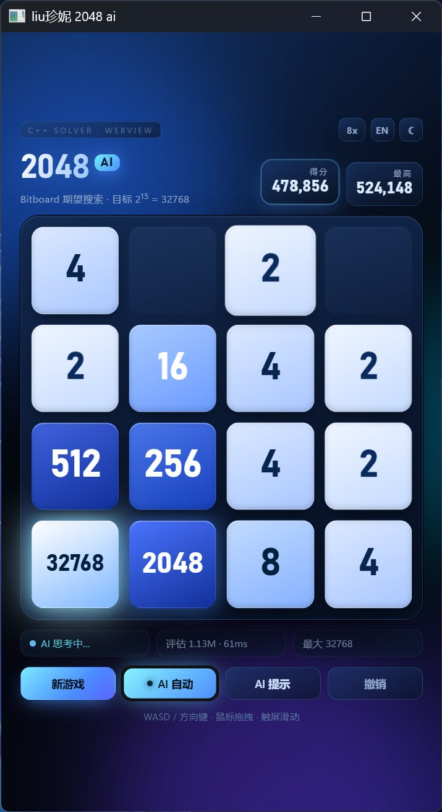

# Liu 2048 AI

A 2048 solver that plays the game better than most humans and shows its work: a
bitboard expectimax engine with a compact line-pattern evaluation, shipped both
as a Windows desktop app and as a browser build that runs the same search in
WebAssembly across a pool of Web Workers.



## Two builds, one engine

| Build | Path | Search | Speed |
|---|---|---|---|
| Desktop console / WebView2 app | `native/` | C++20, 16 threads | 70 moves/s on 8C/16T |
| Browser | `web/` | WebAssembly + Web Workers | ~32 ms per move on 8 workers (depth 5) |

The desktop app is the strong one. The browser build runs the identical
algorithm, at a depth the device can afford; it picks its own depth per move so
that a phone and a workstation feel similar.

## Measured results

All numbers below are 40 independent games on one machine (Ryzen 7 8845H,
8 cores / 16 threads), target tile 32768, 8 games running in parallel:

| Search budget | Average depth | Games reaching 32768 | Average score |
|---|---|---|---|
| 2^19 | 4.5 plies | 19/40 (48%) | 398,237 |
| **2^21 (default)** | **5.2 plies** | **24/40 (60%)** | **415,992** |

Going deeper is not automatically better, which is why 2^21 is the default: the
depth the probe returns is an integer, so a 1.5x budget increase leaves the
midgame depth almost unchanged while pushing the endgame one ply deeper, and
that costs 2.5x the time for less strength. Measured at the same seeds: 2^19
5/8, 2^21 7/8, 1.5x 4/8, 2^22 5/8.

The browser build reaches depth 5 in about 32 ms per move on eight workers; in
headless play at depth 4 it averages 16 moves/s on a single thread.

## How the engine works

- **Board.** Sixteen cells packed as four 16-bit rows, one 4-bit tile rank per
  cell. A move is four table lookups, and up/down go through a nibble transpose.
- **Search.** Expectimax over the real spawn distribution (90% twos, 10% fours).
  There is no pruning of the four-spawn branch: dropping it in the last plies
  makes the engine assume only twos appear, which measurably loses games.
- **Evaluation.** Five features per line - free cells, merge potential,
  monotonicity, tile magnitude, and a constant - precomputed into a
  65,536-entry table, summed over the four rows and four columns. Weights:
  `200000 + 270*empty + 700*merges - 47*mono - 11*sum`, with tile magnitudes
  raised to 3.5 (sum) and 4.0 (monotonicity). Re-tuning these at the default
  depth produced no improvement in 40-game samples, so they are left as they are.
- **Transposition table.** 2^18 slots, and an entry is accepted when it was
  searched *at least* as deep as the request. That single policy is worth about
  1.5x throughput at equal depth; requiring an exact depth match makes almost
  every lookup miss.
- **Depth.** A breadth-first probe counts distinct boards under a node budget
  and returns the number of layers that fit. Counting distinct boards is much
  cheaper than counting tree nodes, and it tracks the position: a crowded board
  gets a deeper search than a wide-open one.
- **Parallelism.** The root chance node is cut into one task per (direction,
  spawn cell) - about 40 short tasks - and handed to a persistent worker pool.
  Uneven four-way slices used to leave cores idle; per-cell tasks keep all of
  them busy.

## Running the desktop build

```
2048AI-console.exe                 # interactive: arrows/WASD, space toggles the AI
2048AI-console.exe --quiet --delay 0 --target 32768 --seed 200 --threads 1
2048AI-console.exe --help          # every knob, including --budget and --threads
```

```
2048AI-web.exe                     # WebView2 window, animated board
```

Both are statically linked and need no runtime. The WebView2 build uses the
WebView2 runtime that ships with Windows 10 and 11.

## Running the browser build

Serve `web/` over HTTP (workers and WebAssembly will not load from `file://`):

```
cd web && python -m http.server 8080
# then open http://127.0.0.1:8080/  (add ?auto=1 to start the AI immediately)
```

Swipe on a phone: the move fires as soon as the finger travels far enough to
name a direction, without waiting for the finger to lift. Manual moves animate a
little slower than the AI's own pace on purpose - at 8x the tiles are a blur,
which is fine to watch and confusing to play.

## Building from source

Desktop (MSVC, C++20):

```
native\build.bat          # WebView2 app -> build\Game2048AI.exe
native\build-console.bat  # console app  -> build\2048ai.exe
```

The WebView2 build expects the SDK in `native/third_party/WebView2`
(`include/` and `x64/WebView2Loader.dll.lib`).

Browser search core:

```
cd web/wasm
npm install assemblyscript
npx asc solver.ts -o solver.wasm --optimize --runtime stub --noAssert
```

Headless benchmark for the WebAssembly core (plays real games, prints hit rate
and speed):

```
node tools/nodebench.mjs --games 6 --target 32768 --depth 4
```

## Licence

MIT. See `LICENSE`.
