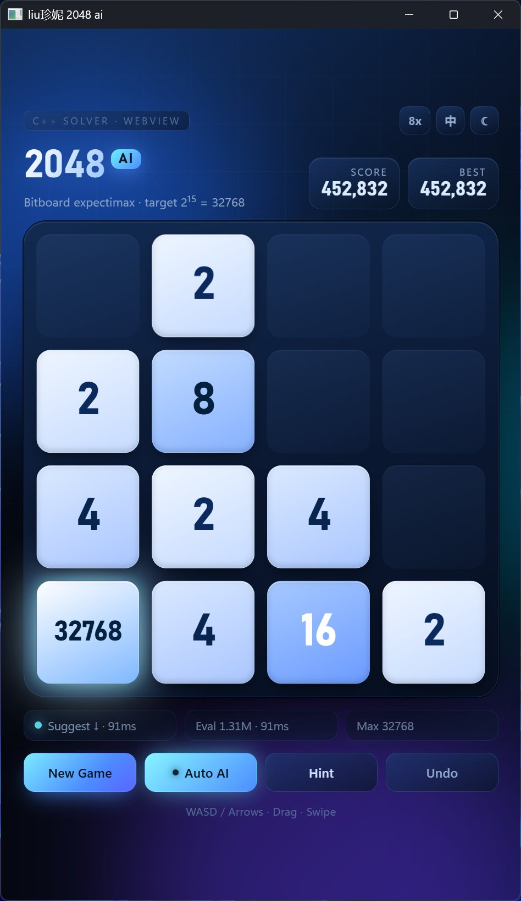
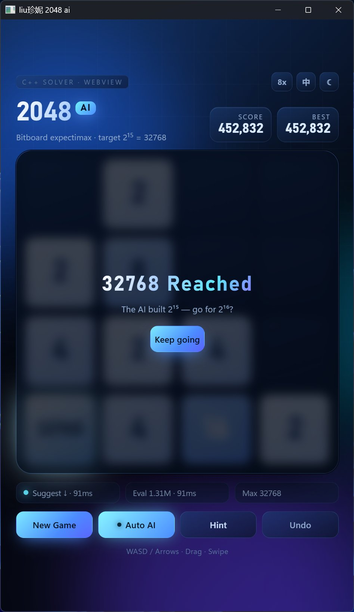

# Liu 2048 AI

A 2048 solver that plays the game better than most humans and shows its work: a
bitboard expectimax engine with a compact line-pattern evaluation, shipped both
as a Windows desktop app and as a browser build that runs the same search in
WebAssembly across a pool of Web Workers.

<p align="center">
  
  
</p>

<p align="center"><sub>WebView2 build, 8x speed: the AI builds the 32768 tile at a score of 452,832, then offers to keep going.</sub></p>

Play it in the browser: **https://01arcticfox.github.io/Liu-2048-ai/** - append
`?auto=1` to watch the AI from the first move.

## Two builds, one engine

| Build | Path | Search | Speed |
|---|---|---|---|
| Desktop console / WebView2 app | `native/` | C++20, up to 16 threads | 46+ moves/s on 16 threads |
| Browser | `web/` | WebAssembly + Web Workers, fine-grained task queue | ~27 ms per move on 16 workers (depth 4) |

The desktop app is the strong one. The browser build runs the identical
algorithm, at a depth the device can afford; it picks its own depth per move so
that a phone and a workstation feel similar.

## Measured results

All numbers below are 40 independent games on one machine (Ryzen 7 8845H,
8 cores / 16 threads), target tile 32768, 8 games running in parallel:

| Search budget | Average depth | Games reaching 32768 | Average score at 32768 | Average score, all 40 games |
|---|---|---|---|
| 2^19 | 4.5 plies | 19/40 (48%) | **452,860** | 398,237 |
| **2^21 (default)** | **5.2 plies** | **24/40 (60%)** | **452,861** | **415,992** |

Both budgets land within one point of each other at 32768, which is expected: the
score is a function of the tile chain, so reaching 32768 always pays about
452,900. The all-games column is lower only because the runs that stop at 16384
(about 367,000 each) are averaged in.

Going deeper is not automatically better, which is why 2^21 is the default: the
depth the probe returns is an integer, so a 1.5x budget increase leaves the
midgame depth almost unchanged while pushing the endgame one ply deeper, and
that costs 2.5x the time for less strength. Measured at the same seeds: 2^19
5/8, 2^21 7/8, 1.5x 4/8, 2^22 5/8.

Everything else in the search was measured the same way, and at this point most
of it does not pay - the engine sits at a local optimum for this evaluation:

| Change | Measured on the 32768 position | Result |
|---|---|---|
| table 2^20 / 2^21 / 2^22 | 200 moves, 16 workers | 10% fewer nodes with one worker, 2% slower with sixteen |
| depth-preferred replacement | 200 moves, 1 worker | 11% more nodes, hit rate 73% -> 70% |
| two slots per bucket | same | neutral (71.5% hit rate) |
| node budget instead of the probe | same | 2x the nodes for +0.3 ply, identical play |
| one extra ply at three free cells | same | 2.6x the time for the same score |
| reusing the probe depth for 3-6 moves | same | 0.4 s saved per 200 moves, but nodes rise whenever a merge opens the board |

Two settings moved the result: formation pruning on and 2^21 instead of 2^19.
Both are defaults. The released build also pins the transposition table to 2^18
slots, keeps the depth-preferred replacement policy, leaves four-spawn pruning
off, and uses no positional bias in the evaluator.

The browser build runs the same search on up to sixteen workers: about 27 ms per
move at four plies, which plays at roughly nine moves per second at 8x playback.
One more ply costs thirteen times as much there, so the open board stays at four
and only the crowded endgame pays for five.

## How the engine works

- **Board.** Sixteen cells packed as four 16-bit rows, one 4-bit tile rank per
  cell. A move is four table lookups, and up/down go through a nibble transpose.
- **Search.** Expectimax over the real spawn distribution (90% twos, 10% fours).
  There is no pruning of the four-spawn branch: dropping it in the last plies
  makes the engine assume only twos appear, which measurably loses games.
  Formation pruning is enabled and only filters directions after the large-tile
  layout changes; it is part of the shipped configuration.
- **Evaluation.** Five features per line - free cells, merge potential,
  monotonicity, tile magnitude, and a constant - precomputed into a
  65,536-entry table, summed over the four rows and four columns. Weights:
  `200000 + 270*empty + 700*merges - 47*mono - 11*sum`, with tile magnitudes
  raised to 3.5 (sum) and 4.0 (monotonicity). Re-tuning these at the default
  depth produced no improvement in 40-game samples, so they are left as they are.
- **Transposition table.** 2^18 slots, and an entry is accepted when it was
  searched *at least* as deep as the request. That single policy is worth about
  1.5x throughput at equal depth; requiring an exact depth match makes almost
  every lookup miss.
- **Depth.** A breadth-first probe counts distinct boards under a node budget
  and returns the number of layers that fit. Counting distinct boards is much
  cheaper than counting tree nodes, and it tracks the position: a crowded board
  gets a deeper search than a wide-open one.
- **Parallelism.** The root chance node is cut into one task per (direction,
  spawn cell) - about 40 short tasks - and handed to a persistent worker pool.
  Uneven four-way slices used to leave cores idle; per-cell tasks keep all of
  them busy. The browser build splits each cell further into eight WebAssembly
  tasks (two spawn values times four follow-up moves), so sixteen workers stay
  busy through the tail of a deep search without changing the search value.

## Running the desktop build

```
2048AI-console.exe                 # interactive: arrows/WASD, space toggles the AI
2048AI-console.exe --quiet --delay 0 --target 32768 --seed 200 --threads 1
2048AI-console.exe --help          # every knob, including --budget and --threads
```

```
2048AI-web.exe                     # WebView2 window, animated board
```

Both are statically linked and need no runtime. The WebView2 build uses the
WebView2 runtime that ships with Windows 10 and 11.

## Running the browser build

Serve `web/` over HTTP (workers and WebAssembly will not load from `file://`):

```
cd web && python -m http.server 8080
# then open http://127.0.0.1:8080/  (add ?auto=1 to start the AI immediately)
```

Swipe on a phone: the move fires as soon as the finger travels far enough to
name a direction, without waiting for the finger to lift. Manual moves animate a
little slower than the AI's own pace on purpose - at 8x the tiles are a blur,
which is fine to watch and confusing to play.

## Building from source

Desktop (MSVC, C++20):

```
native\build.bat          # WebView2 app -> build\Game2048AI.exe
native\build-console.bat  # console app  -> build\2048ai.exe
```

The WebView2 build expects the SDK in `native/third_party/WebView2`
(`include/` and `x64/WebView2Loader.dll.lib`).

Browser search core:

```
cd web/wasm
npm install assemblyscript
npx asc solver.ts -o solver.wasm --optimize --runtime stub --noAssert
```

Headless benchmark for the WebAssembly core (plays real games, prints hit rate
and speed):

```
node tools/nodebench.mjs --games 6 --target 32768 --depth 4
```

## Licence

MIT. See `LICENSE`.
