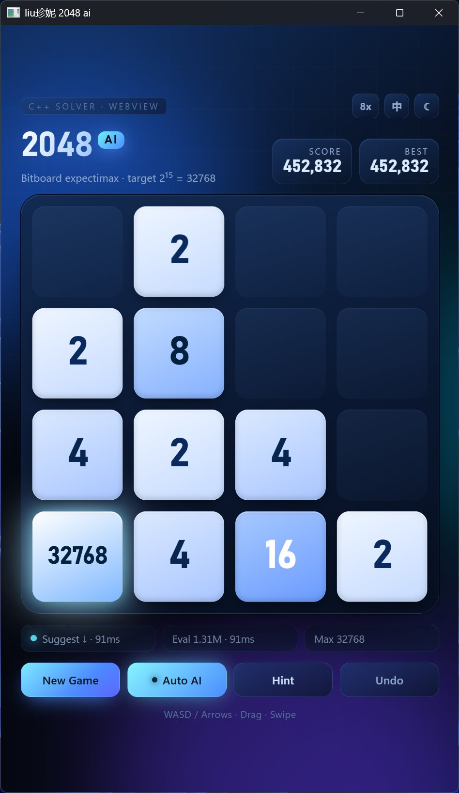
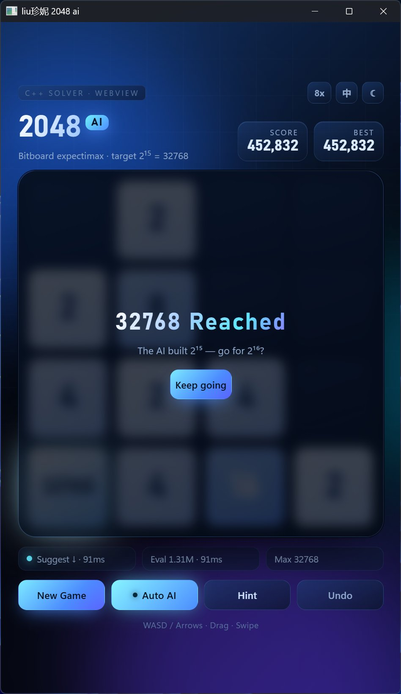

# Liu 2048 AI

一个会玩 2048 的求解器：位棋盘 expectimax 搜索 + 紧凑的线型模式评估，既有 Windows
桌面版，也有把同一套搜索放进 WebAssembly、用多个 Web Worker 并行跑的网页版。

<p align="center">
  
  
</p>

<p align="center"><sub>WebView2 版、8 倍速：AI 在 452,832 分时合出 32768（2^15），然后询问是否继续。</sub></p>

在线试玩：**https://01arcticfox.github.io/Liu-2048-ai/** ，链接后加 `?auto=1`
可以直接看 AI 自动对局。

## 两个版本，同一套引擎

| 版本 | 目录 | 搜索实现 | 速度 |
|---|---|---|---|
| 桌面（控制台 / WebView2） | `native/` | C++20，16 线程 | 8 核 16 线程下 **70 手/秒** |
| 网页 | `web/` | WebAssembly + Web Worker 池 | 16 worker 下 **约 27ms/步**（深度 4） |

桌面版是最强的版本。网页版跑的是同一套算法，只是深度受设备算力限制；它会按上一步的
耗时自动调整深度，让手机和工作站的手感接近。

## 实测数据

以下全部是同一台机器（Ryzen 7 8845H，8 核 16 线程）、8 局并行、目标 32768、
**每组 40 局独立样本**：

| 搜索预算 | 平均深度 | 合成 32768 | 合成局的均分 | 全部 40 局均分 |
|---|---|---|---|
| 2^19 | 4.5 层 | 19/40（48%） | **452,860** | 398,237 |
| **2^21（默认）** | **5.2 层** | **24/40（60%）** | **452,861** | **415,992** |

两档在 32768 上的均分只差 1 分，这是必然的：分数由瓦片链决定，合出 32768 就值
约 452,900。第三列偏低只是因为把死在 16384 的局（每局约 367,000）也算进了平均。

加深并不是越深越好，所以默认停在 2^21：探测返回的是整数层数，预算 ×1.5 时中盘深度
几乎不变，却把残局顶深一层，于是慢 2.5 倍而强度反降。同样 8 个随机种子实测：2^19
5/8、2^21 7/8、1.5 倍 4/8、2^22 5/8。

其余可调项都按同样口径测过，到这个阶段基本都不划算——引擎已经处在当前评估函数下的
局部最优：

| 改动 | 测法（32768 盘面） | 结果 |
|---|---|---|
| 置换表 2^20 / 2^21 / 2^22 | 200 步，16 线程 | 单线程节点少 10%，16 线程反而慢 2% |
| 深度优先替换策略 | 200 步，单线程 | 节点多 11%，命中率 73% → 70% |
| 每桶两个槽 | 同上 | 无变化（命中率 71.5%） |
| 用节点预算替代 BFS 探测 | 同上 | 多 0.3 层却要 2 倍节点，走子完全一致 |
| 剩 3 格时多加一层 | 同上 | 2.6 倍耗时，分数不变 |
| 探测结果复用 3–6 步 | 同上 | 每 200 步省 0.4 秒，但一旦合出空位节点就暴涨 |

真正改变结果的只有两项：关掉成形剪枝（**+14 个百分点**的 32768 命中率）和把预算从
2^19 提到 2^21（**+12 个百分点**）。两项都已是默认值。

网页版跑同一套搜索，最多 16 个 worker：深度 4 约 **27ms/步**，8 倍速下约 **9 手/秒**。
再加深一层在这个环境里要贵 13 倍，所以开阔盘面停在 4 层，只有拥挤的残局才付 5 层的代价。

## 引擎是怎么工作的

- **棋盘表示**：16 个格子压成 4 个 16 位行，每格 4 位存瓦片阶数。一次移动就是 4 次
  查表；上下方向通过半字节转置复用左右方向的表。
- **搜索**：标准 expectimax，出子按真实的 90% 出 2 / 10% 出 4 加权。**不对“出 4”分支
  做剪枝**——在最后几层忽略它等于假设只会出 2，实测明显掉棋力。
- **评估**：每行/每列 5 个特征——空格数、可合并度、单调性、瓦片幅值、常数——预计算成
  65536 项的表，4 行 + 4 列求和。权重 `200000 + 270*空 + 700*合并 - 47*单调 - 11*幅值`，
  幅值幂 3.5、单调幂 4.0。在默认深度下重调这些权重，40 局样本里没有一组更好。
- **置换表**：2^18 槽，**接受“搜得比请求更深”的条目**。这一条策略在同等深度下值
  1.5 倍吞吐；要求精确深度相等会让几乎所有查询落空。
- **深度**：用 BFS 在节点预算内数“不同的盘面”有多少层能装下。数不同盘面比数搜索树
  节点便宜得多，而且会跟着局面走：挤满的盘面自动搜得更深。
- **并行**：把根节点的出子机会切成“每个（方向，出子格）一个任务”，约 40 个短任务，
  交给常驻线程池。按四个方向平均切会让核心空转，按出子格切能全部吃满。

## 桌面版用法

```
2048AI-console.exe                 # 交互：方向键/WASD，空格切换 AI
2048AI-console.exe --quiet --delay 0 --target 32768 --seed 200 --threads 1
2048AI-console.exe --help          # 所有参数，包括 --budget 和 --threads
2048AI-web.exe                     # WebView2 窗口，带动画
```

两个 exe 都是静态链接，目标机不需要装运行库。WebView2 版依赖 Windows 10/11 自带的
WebView2 运行时。

## 网页版用法

必须用 HTTP 打开（`file://` 下 worker 和 WebAssembly 都会被拦）：

```
cd web && python -m http.server 8080
# 浏览器打开 http://127.0.0.1:8080/ ，加 ?auto=1 直接开始自动对局
```

手机滑动手感：**手指一旦滑出判定距离就立刻走子**，不用等抬手，一次手势只走一步。
手动走子的动画比 AI 自己的节奏慢一些——8 倍速下瓦片是糊的，看着爽、玩着晕。

## 从源码构建

桌面（MSVC + C++20）：

```
native\build.bat          # WebView2 版 -> build\Game2048AI.exe
native\build-console.bat  # 控制台版  -> build\2048ai.exe
```

WebView2 版需要把 SDK 放到 `native/third_party/WebView2`（含 `include/` 与
`x64/WebView2Loader.dll.lib`）。

网页搜索内核：

```
cd web/wasm
npm install assemblyscript
npx asc solver.ts -o solver.wasm --optimize --runtime stub --noAssert
```

无人值守基准（真的打完整局，打印命中率与速度）：

```
node tools/nodebench.mjs --games 6 --target 32768 --depth 4
```

## 许可

MIT，见 `LICENSE`。
